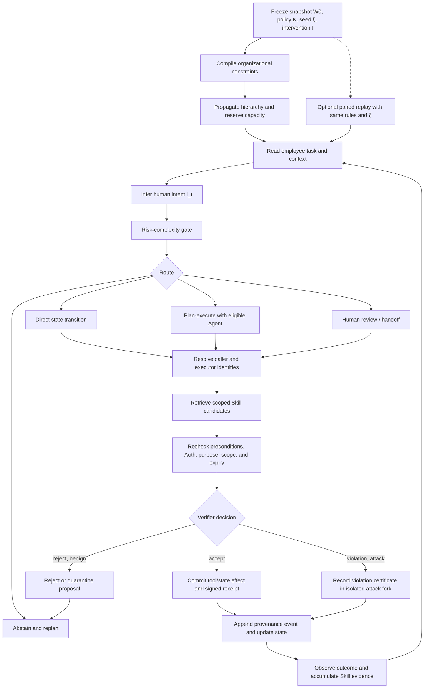
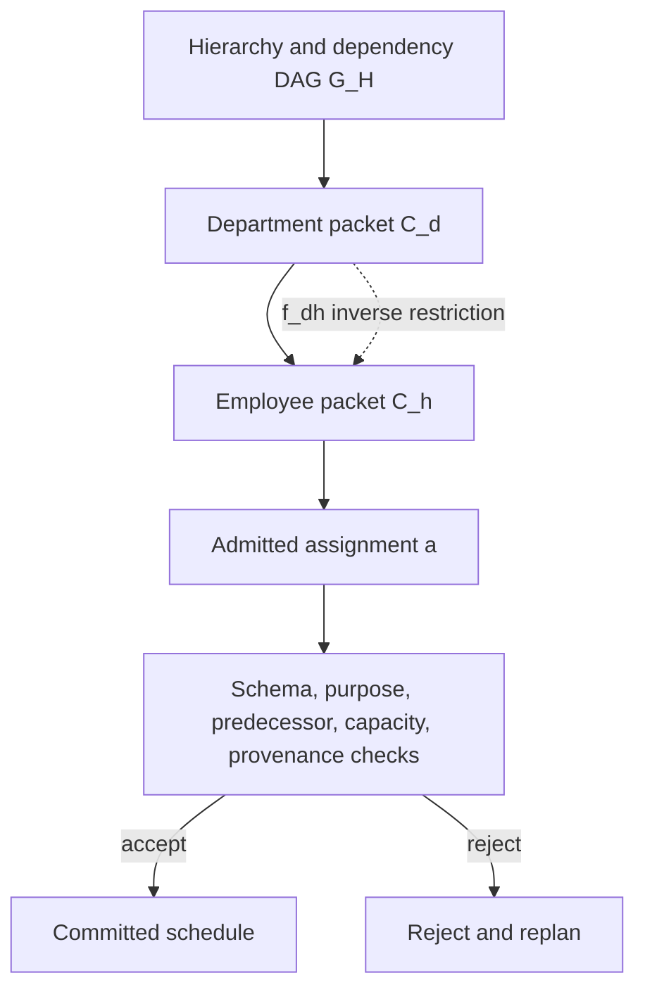
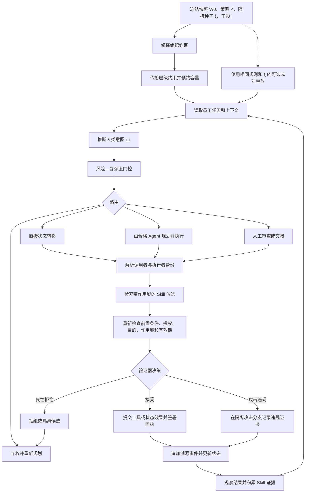
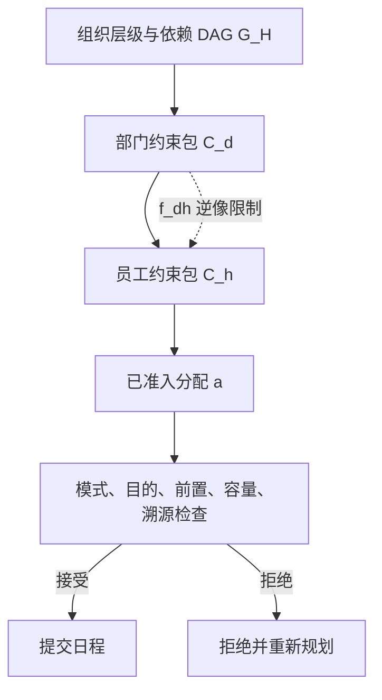

# 3 Method: Morpheus-Harness

## Overview and claims

Morpheus-Harness generates auditable enterprise behavior trajectories in which organizational constraints, human intent, Agent routing, delegated authority, tool effects, and procedural memory are explicit state variables. The method has four stages. First, it compiles a frozen enterprise snapshot into a typed event workflow. Second, it propagates organizational constraints through a hierarchy and reserves finite capacity before a schedule is accepted. Third, it maps a human task to an intent, selects a route, resolves an executor identity, and rechecks authorization at every tool boundary. Fourth, it turns only repeatedly observed and verified behavior into a scoped skill, then replays that skill under current policy before reuse.

An LLM may propose an intent, plan, message, or tool action. A deterministic verifier owns authorization, state transition, capacity reservation, provenance, and postcondition acceptance, following ABAC and zero-trust principles [4,5], purpose restrictions [6], and agent-risk guidance [8,9]. All formal claims below are conditional on those executable checks. The current repository contains the surrounding prototype interfaces, while the full claims require the verifier fields described in Sections 3.2–3.4.

The method distinguishes benign and attack evaluation. In benign mode, a candidate that fails a predicate is rejected or sent to abstention and cannot change enterprise state. In attack mode, the same candidate is recorded with a violation certificate and can be applied only to an isolated sandbox fork. This permits controlled threat generation without claiming that a policy-violating action is benign.

## 3.1 End-to-end workflow

### 3.1.1 Typed enterprise snapshot

At event boundary $t$, the simulator state is

$$
W_t=(G,K_t,H_t,U_t,M_t,\Pi_t,\chi_t,\Gamma_t).
$$

$G=(V,E_h,E_d,E_o,E_v,E_a)$ is a typed graph of employees, departments, Agents, runtimes, resources, tools, goals, and recipients. The edge sets encode hierarchy, task precedence, ownership, visibility, and authority or delegation. $K_t$ contains role permissions, purpose restrictions, time windows, approval requirements, and information-flow boundaries. $H_t$ contains organizational goals and dependencies. $U_t$ is the state of tools and artifacts. $M_t$ is scoped procedural memory. $\Pi_t$ is the provenance graph. $\chi_t$ is time and session state. $\Gamma_t$ is the remaining capacity calendar, with $\Gamma_t(r,\tau)$ denoting the unreserved capacity of resource $r$ at time slot $\tau$.

A trajectory is a sequence of typed events

$$
\tau=(e_1,\ldots,e_T),
$$

where

$$
 e_t=(id,source,human,caller,executor,runtime,session,intent,route,plan,hand\!off,object,operation,scope,recipient,result,\Delta U,parents,policy,intervention).
$$

`caller` and `executor` are separate. The caller is the employee or upstream Agent that requests work. The executor is the identity that issues the tool call. `parents` contains canonical provenance parent IDs. A tool or state-effect event is accepted only with a policy decision, a result receipt, and a state-diff receipt.

The event generator is factorized as

$$
q_\theta(e_t\mid W_t,I_t)=q_\theta(i_t\mid h_t,W_t,I_t)\cdot q_\theta(r_t\mid i_t,W_t)\cdot q_\theta(x_t\mid r_t,i_t,W_t)\cdot q_\theta(a_t\mid x_t,W_t).
$$

where $i_t$ is human intent, $r_t$ is a route, $x_t$ is the resolved executor and handoff, and $a_t$ is the concrete action. The transition $W_{t+1}=F(W_t,e_t)$ is executed only after verification.

### 3.1.2 Workflow graph



### 3.1.3 End-to-end pseudocode

```text
Algorithm 0: MORPHEUS-HARNESS(W0, intervention I, common randomness ξ, mode z)

1  W ← restore(W0); initialize canonical provenance roots and empty trace τ
2  C ← COMPILE-AND-PROPAGATE(G, H, K); atomically admit each scheduled task and reserve its employee/resource capacity before routing
3  for each scheduled employee boundary t do
4      context ← READ-CONTEXT(W, C, χ)
5      intent ← HUMAN-INTENT(context, I)
6      route ← ROUTE(intent, W, C)
7      if route = Abstain then release this task’s outstanding reservation; append review event; continue
8      executor ← RESOLVE-IDENTITY(human, route, operation)
9      skill ← RETRIEVE-ADMISSIBLE-SKILL(M, context, K, provenance)
10     proposal ← PROPOSE(intent, route, executor, skill, W, ξ)
11     receipt ← VERIFY(proposal, W, C, K, Π)
12     if receipt = Reject and z = benign then release this task’s outstanding reservation; quarantine proposal; replan; continue
13     if receipt = Violation and z ≠ benign then
14         append violation certificate; apply only to isolated attack fork
15     if receipt = Accept then
16         consume the admitted reservation atomically; apply F; append result and state receipts
17     UPDATE-SKILL-EVIDENCE(M, receipt, provenance)
18 return τ, W, certificates
```

A paired experiment runs Algorithm 0 twice from the exact same snapshot and uses the same route-selection procedure, verifier, and transition rules. The intervention manifest changes exactly one variable, such as intent, delegation scope, source object, recipient, or Skill provenance. Thus the attack branch cannot silently obtain an additional route or a different policy oracle.

### 3.1.4 Threat predicate

A source entering an Agent context is not automatically an insider. The authority model follows authorized-access and valid-account threat definitions [1–3], while the Agent-specific boundary cases are grounded in recent injection and trajectory studies [10–19]. Let $H$ and $A$ be human and enterprise-Agent principals. Let $B_K$ be the forbidden data-flow and purpose-boundary relation. A trace is an Agent-mediated insider threat when

$$
\operatorname{Threat}(\tau)=1
\iff \exists e_t\in\tau:\quad
\operatorname{authpath}(e_t)\neq\varnothing
\land \operatorname{principal}(e_t)\in H\cup A
\land \operatorname{flow}(e_t)\in B_K
\land \operatorname{effectWitness}(e_t)=1.
$$

The source, enterprise authority, executor, and effect remain separate labels, following typed provenance principles [20] and recent agent attack benchmarks [10–12]. This distinction prevents an externally supplied prompt injection from being mislabeled as an employee incident merely because an enterprise Agent executed it.

## 3.2 Organizational Constraints and Hierarchical Planning

We compile organizational state before any employee event is routed. Let $G_H=(V,E_H)$ be the acyclic organizational hierarchy and dependency graph. Each node $v$ has an action universe $A_v$, a local admissible set $L_v\subseteq A_v$, and a constraint packet $C_v\subseteq A_v$. A packet contains the goal, visible resources, allowed tools, prerequisites, approval/delegation edges, valid slots, business purpose, and provenance. Meeting minutes are proposals. The compiler accepts them only after schema, role, purpose, dependency, time, capacity, and provenance checks.

For every edge $u\to v$, let $f_{uv}:A_v\to A_u$ project a child assignment onto the parent object it consumes. The child packet is defined by intersection:

$$
C_v=L_v\cap\bigcap_{u\to v}f_{uv}^{-1}(C_u).
$$

For a path $p=(v_0\to v_1\to\cdots\to v_k)$, define

$$
f_p=f_{v_0v_1}\circ f_{v_1v_2}\circ\cdots\circ f_{v_{k-1}v_k}.
$$

The inverse-image identity

$$
f_p^{-1}(C_{v_0})
=f_{v_{k-1}v_k}^{-1}(\cdots f_{v_0v_1}^{-1}(C_{v_0})\cdots)
$$

is the mechanism that preserves upstream restrictions. An infeasible intersection yields a reject-and-replan result rather than an unverified schedule.




### Theorem 1 (Hierarchical scope soundness)

Assume $G_H$ is a DAG, every $f_{uv}$ is total on the admitted child domain, and every local compiler emits only elements of $L_v$. For every node $v$, every accepted $a\in C_v$ belongs to $L_v$ and satisfies every ancestor constraint pulled back along every path to $v$. Equivalently,

$$
a\in L_v\cap\bigcap_{p:r\leadsto v}f_p^{-1}(C_r),
$$

where $r$ ranges over ancestors of $v$.

**Proof.** Induct on topological depth. At a root, $C_r=L_r$, so the claim follows from local compilation. For node $v$, the intersection definition gives $a\in L_v$ and $f_{uv}(a)\in C_u$ for every parent $u$. By induction, each $f_{uv}(a)$ satisfies every ancestor restriction of $u$. Composing the projections gives $f_p(a)\in C_r$ for every path $p:r\leadsto v$. Thus the claim holds for $v$. $\square$


#### Lean-checked hierarchy lemma

The following core lemma checks that effective authorization along a hierarchy path is exactly the root predicate conjoined with every path restriction. It was checked with Lean 4.8.0 using only the core library.

```lean
namespace Morpheus

variable {A E I S C : Type}

def effective (root : A → Prop) : List (A → Prop) → A → Prop
  | [], a => root a
  | p :: ps, a => p a ∧ effective root ps a

theorem inherited (root : A → Prop) (path : List (A → Prop)) (a : A) :
    effective root path a ↔ root a ∧ ∀ p ∈ path, p a := by
  induction path with
  | nil => simp [effective]
  | cons p ps ih =>
    simp [effective, ih, and_comm, and_left_comm, and_assoc]
end Morpheus
```

### Theorem 2 (Predecessor and capacity invariant)

A task $j$ assigned to employee $h$ and slot $s$ may start only after every predecessor has an accepted completion receipt. Let $R_{h,s}$ be the sum of reservations of admitted, unfinished attempts for $(h,s)$, and let $U_{h,s}$ be the sum of actual consumed work. For every resource $r$, define $R_{r,s}$ and $U_{r,s}$ analogously. Assume capacities $Cap_{h,s}$ and $Cap_{r,s}$ are nonnegative and frozen or changed only by the same transaction protocol. Admission allocates one unique reservation per task attempt and enforces

$$
U_{h,s}+R_{h,s}\le Cap_{h,s},
\qquad
U_{r,s}+R_{r,s}\le Cap_{r,s}.
$$

Completion converts its own reservation into actual usage without double counting. Rejection or failure releases only its own outstanding reservation. Then every committed schedule satisfies predecessor and capacity constraints.

**Proof.** Initially all sums are zero or satisfy the inequalities. A task start is admitted only after predecessor receipts are present. The admission transaction adds one unique reservation and checks both inequalities. During execution, actual usage is transferred from that task’s reservation, so $(U+R)$ does not increase beyond the checked bound. Completion removes the task’s remaining reservation and records exactly its actual usage. Failure removes only the attempt’s outstanding reservation and records no uncommitted effect. Other tasks’ terms are unchanged. Induction over atomic admission, execution, completion, and failure transactions proves both predecessor and capacity invariants. $\square$

For example, a finance department may approve a quarterly ledger summary for internal planning-mailbox delivery. The analyst’s packet permits the summary artifact and internal mailbox during the approved slot. A downstream report task cannot start until the ledger-summary receipt is accepted, and cannot add raw transaction records or an external recipient merely because the employee’s general role permits them.

`hierarchical_planning.py` builds the hierarchy from role paths and leader hints. `hierarchical_meeting.py` runs the head-council stage, parallel department meetings, and structured artifact writes. The current prototype does not yet implement $f_{uv}$-based packet compilation, atomic reservations, or receipt verification. These theorems state the required defensive extension, not an already enforced property.

## 3.3 Purpose-Bound Routing and Complete-Mediation Execution

We separate a decision into a route choice and an executor choice. At event boundary $t$, employee $h$ and task $j$ carry a signed purpose token

$$
\mu_{h,j}=\operatorname{Sign}_{h}(j,\rho,\mathcal{S},\mathcal{R},[b,e],\nu),
$$

where $\rho$ is the declared business purpose, $\mathcal{S}$ is the source-object set, $\mathcal{R}$ is the recipient set, $[b,e]$ is the validity interval, and $\nu$ is a nonce. The verifier checks the signature, current time, employee role, and current approval before any model proposal can affect the simulated enterprise state. This follows attribute-based authorization [4], purpose restriction [6], and the separation between the subject and acting party in delegated authorization [7]. A proposal is well typed only if its intent type $\iota_{h,j}$ is included in the type set signed by $\mu_{h,j}$. A summary intent may therefore be typed as `summarize`, while `export`, `external_share`, or `permission_grant` require distinct purpose and approval types.

The first stage selects $q_t$ from the route set $\{\mathsf{State},\mathsf{PlanExecute},\mathsf{Handoff},\mathsf{Abstain}\}$. The route feature is $\phi_t=(d_t,k_t,r_t,u_t,\ell_t)$, containing estimated plan depth, tool count, policy risk, uncertainty, and information-flow sensitivity. The second stage ranks an executor set $E(q_t)$ using only candidates whose identity, capability, tool scope, memory scope, and approval state satisfy the current packet $C_v$ and signed purpose. The selected pair is

$$
(q_t,e_t)=\arg\min_{(q,e)\in\mathcal{F}(\phi_t)} c_{q,e},
$$

where $\mathcal{F}(\phi_t)$ contains only pairs with calibrated rejection risk at most $\varepsilon$, calibrated task-success probability at least $\eta$, and uncertainty at most $u_{\max}$. Costs include model calls, tokens, latency, and review effort. If no pair is feasible, or if the intent is outside $\mu_{h,j}$, the controller chooses $\mathsf{Abstain}$ and emits a review record. It never widens the purpose, scope, recipient set, or approval state to avoid abstention.

Consider a finance employee preparing a quarterly revenue summary for an internal planning recipient. The signed token permits `summarize` over the quarter’s approved ledger objects, permits the internal planning mailbox, and expires at quarter close. The route controller may select $\mathsf{PlanExecute}$ because the task requires repository retrieval and aggregation. Executor ranking can select the enterprise data Agent only if its delegated scope includes those ledger objects and the planning mailbox. A proposal to send the summary to a personal address has an otherwise plausible plan, but its recipient is outside $\mathcal{R}$ and is rejected. A proposal to grant another Agent access is also rejected because `permission_grant` is not in the signed intent type set. The rejection is recorded with the failed predicate and no unauthorized state transition is committed.

### Theorem 3. Per-step safety by complete mediation

Assume the initial state satisfies the policy invariant, every route and executor proposal passes through the verifier, and the verifier checks signature, intent type, role, current approval, delegation scope, time, tool preconditions, recipient boundary, and memory scope immediately before commit. Then every committed step satisfies authorization.

**Proof.** Consider the four operational cases. A `State` step commits only after the session and time predicates pass. A `PlanExecute` step commits a tool effect only after the executor action passes every predicate. A `Handoff` step first validates the approval edge and then applies the same action checks under the newly scoped identity. `Abstain` commits no enterprise effect. Thus each committed step preserves the invariant. Induction over $t$ proves the claim. A failed proposal is a rejection event, not an unauthorized commit. $\square$

### Theorem 4. Simultaneous fixed-bin route control

Partition feature space into fixed bins $B$. For every bin $b$ and route–executor pair $r$, collect $n_{b,r}$ independent calibration examples. Let $\widehat v_{b,r}$ be the rejection rate and $\widehat s_{b,r}$ the success rate. With $\mathcal{R}$ fixed before calibration, define

$$
U_{b,r}=\widehat v_{b,r}+\sqrt{\frac{\log(2|B||\mathcal{R}|/\delta)}{2n_{b,r}}},\qquad
L_{b,r}=\widehat s_{b,r}-\sqrt{\frac{\log(2|B||\mathcal{R}|/\delta)}{2n_{b,r}}}.
$$

With probability at least $1-\delta$, all fixed-bin pairs simultaneously satisfy $v_{b,r}\le U_{b,r}$ and $s_{b,r}\ge L_{b,r}$. Therefore, when cost and selection are fixed per stratum, selecting the least-cost pair with $U_{b,r}\le\varepsilon$ and $L_{b,r}\ge\eta$ meets both constraints.

**Proof.** Apply Hoeffding’s inequality to each fixed bin and pair, then apply a union bound over $|B||\mathcal{R}|$ pairs [32]. The controller selects only pairs whose simultaneous bounds pass. $\square$

### Theorem 5. Cost monotonicity

For a bin $b$, let $\mathcal{F}_b$ be the feasible pair set and $C_b^*=\min_{r\in\mathcal{F}_b}c_{b,r}$. If additional compliant route–executor pairs are added without changing existing costs or constraints, then $C_b^*$ cannot increase.

**Proof.** The old feasible set is a subset of the new set, so the minimum over the new set is no larger. $\square$

The prototype preserves this interface through `src/behavior_router.py`, while `src/harness_task.py`, `src/agent_registry.py`, and `src/deepseek_runtime.py` supply the handoff, identity, scope, approval, and session evidence needed by the verifier.


#### Lean-checked route lemma

The candidate list is ordered by cost and stable identity before selection. The checked lemma states that a returned executor belongs to the candidate list and passes both intent compatibility and the current permission predicate.

```lean
namespace Morpheus
variable {E I : Type}

-- The order of es is fixed before selection, e.g. by cost and stable ID.
def firstEligible (ok : E → Bool) : List E → Option E
  | [] => none
  | e :: es => if ok e then some e else firstEligible ok es

theorem validates (ok : E → Bool) (es : List E) (e : E)
    (hit : firstEligible ok es = some e) : e ∈ es ∧ ok e = true := by
  induction es with
  | nil => simp [firstEligible] at hit
  | cons h t ih =>
    by_cases valid : ok h = true
    · simp [firstEligible, valid] at hit
      subst e
      exact ⟨by simp, valid⟩
    · simp [firstEligible, valid] at hit
      obtain ⟨mem, pass⟩ := ih hit
      exact ⟨List.mem_cons_of_mem _ mem, pass⟩

-- The first stage returns an intent. Both gates are recomputed on that intent.
def route (intent : I) (fits permits : I → E → Bool) (es : List E) :=
  firstEligible (fun e => fits intent e && permits intent e) es

theorem routed (i : I) (fits permits : I → E → Bool) (es : List E) (e : E)
    (hit : route i fits permits es = some e) :
    e ∈ es ∧ fits i e = true ∧ permits i e = true := by
  obtain ⟨mem, pass⟩ := validates _ _ _ hit
  exact ⟨mem, by simpa using pass⟩
end Morpheus
```

## 3.4 Skill accumulation and reuse

### 3.4.1 Admission from verified, parameterized evidence

A Skill is a finite-state procedure, not a free-form memory paragraph:

$$
S=(Q,\Sigma,\delta,q_0,F,trigger,pre,post,scope,expiry,source,version,\rho).
$$

For a binding $b$ (member, tenant, role, purpose, resources, recipient, and approval), one completed session yields a finite receipt trace $R_b=(r_0,\ldots,r_{k-1})$. Receipt $r_j$ records the parameter binding, state transition, action, authorization decision, staged postcondition, and provenance parent. The abstraction map $\alpha(R_b)=S$ is sound only when every abstract edge has a witnessed receipt with the same binding and the recorded authorization and postcondition checks. A sanitized textual summary is therefore an observation, not evidence of a reusable Skill. This is the weakest-precondition discipline of Dijkstra [33].

For deterministic transitions $F_j(s,b)$ and a finite trace of $k$ actions indexed $0,\ldots,k-1$, let $post_j(s,s',b)$ be the staged postcondition for action $j$. Define

$$
WP_k(s)=Goal(s),
$$

and, for $0\le j<k$,

$$
WP_j(s)=pre_j(s,b)\land Auth_j(s,b)\land
post_j(s,F_j(s,b),b)\land WP_{j+1}(F_j(s,b)).
$$

The admission guard is $B_b(s_0)=WP_0(s_0)$, together with complete receipts, a stable source digest, and a successful final postcondition.

**Theorem 6 (finite-trace admission).** For $0\le j\le k$, $WP_j(s)$ holds if and only if the suffix actions $j,\ldots,k-1$ can execute from $s$ with every precondition, authorization, staged postcondition, and the final goal satisfied.

**Proof.** At $j=k$, $WP_k(s)=Goal(s)$. For $j<k$, the definition requires the current precondition and authorization, the staged postcondition after deterministic transition $F_j$, and $WP_{j+1}$ at the resulting state. The induction hypothesis establishes the suffix claim. Thus backward induction proves the equivalence. The index range is finite, so admission is a checked finite-trace claim. $\square$

The design counts $m_b$ distinct completed, independent sessions for the same binding $b$, deduplicated by session ID and receipt digest. A Skill is admitted only when $m_b\ge m_{min}$ and each counted session satisfies $B_b$. The current implementation uses a fixed, versioned enterprise skill catalog. Skill loading is declarative and records the source, revision, scope, procedure steps, and default business fields. It does not learn new skills from activity traces.

For example, a quarterly finance-summary Skill may be admitted after three distinct signed-off sessions with $b=(tenant=\textsf{Acme},role=\textsf{FinanceAnalyst},purpose=\textsf{quarterly\mbox{-}close},recipient=\textsf{finance@acme},approval=\textsf{controller\mbox{-}signed})$. Each receipt must show the same tenant, an authorized internal recipient, the approved source reports, and the final summary postcondition. A cross-tenant binding or an external recipient fails $scope$ or $Auth$ and cannot be admitted or replayed.

### 3.4.2 Scoped retrieval and non-expanding replay

At context $\kappa_t$, retrieval requires $\kappa_t\subseteq scope(S)$, current time before $expiry(S)$, an unchanged $Hash(source(S))$, matching tenant and role, and a satisfied trigger and precondition. Reuse instantiates the Skill with a new binding $b'$ and executes the product transition

$$
(s_j,q_j)\xrightarrow{a_j}(s_{j+1},q_{j+1})
$$

only when the current policy relation $P_{K_t}(s_j,a_j,s_{j+1})$, the Skill edge $\delta(q_j,a_j)=q_{j+1}$, and $post_j(s_j,s_{j+1},b')$ all hold. Failed scope, source, expiry, authorization, precondition, or staged-postcondition checks quarantine the candidate.

**Theorem 7 (Skill non-expansion).** If a finite product trace satisfies these checks at every step and terminates in the Skill goal, its projection onto enterprise states is a valid trace of the current policy. Hence the set of traces reachable through Skills is a subset of the set of all current-policy traces, where the latter permits any policy-authorized action sequence.

**Proof.** Induct on the finite action list. The empty product trace projects to the empty policy trace. For the first product transition, the premise supplies $P_{K_t}$ and the staged postcondition, so its state projection is a valid policy step. The suffix is a product trace from the resulting pair, and the induction hypothesis validates its projection. Closure under concatenation proves the claim. The Skill edge restricts choices and therefore cannot enlarge the policy-trace set. $\square$

This theorem is conditional on rechecking the current policy at every product transition. Reusing a stale summary without these checks is outside the theorem and is the supply-chain failure mode studied by Liu et al. [19].


#### Lean-checked Skill projection

The product-trace projection below checks the core of Theorem 7. The enterprise-policy relation is the first conjunct of every guarded Skill edge.

```lean
namespace Morpheus
variable {A S C : Type}

inductive Run (step : S → A → S → Prop) : S → List A → S → Prop
  | nil (s) : Run step s [] s
  | cons {s t u a as} : step s a t → Run step t as u → Run step s (a :: as) u

def guarded (policy : S → A → S → Prop) (edge : C → A → C → Prop)
    (x : S × C) (a : A) (y : S × C) : Prop :=
  policy x.1 a y.1 ∧ edge x.2 a y.2

theorem reuse (policy : S → A → S → Prop) (edge : C → A → C → Prop)
    {x y : S × C} {as : List A} (trace : Run (guarded policy edge) x as y) :
    Run policy x.1 as y.1 := by
  induction trace with
  | nil => exact .nil _
  | cons h _ ih => exact .cons h.1 ih
end Morpheus
```

## 3.5 Cross-cutting verification, replay, and implementation boundary

### 3.5.1 Provenance and receipts

The provenance graph is a typed DAG with source, context, intent, plan, handoff, tool, result, and effect nodes, following PROV-DM [20]. Every non-root event contains canonical parent IDs and a policy decision. A digest chain

$$
 h_t=H(h_{t-1}\Vert canon(e_t))
$$

makes post-hoc edits detectable inside the replay artifact. Acceptance requires parent existence, parent-type compatibility, state-diff receipt, result hash, and policy fields. The current repository logs Agent identities, caller/executor metadata, session IDs, delegation chains, Skill observations, and outcomes. The surrounding Morpheus/Chimera simulator lineage and auditing baselines motivate this event-level design [14–18]. It does not yet provide a cryptographically anchored audit log or full policy enforcement. The Method treats those as required extensions.

### 3.5.2 Counterfactual paired evaluation

The evaluator freezes $W_0$, restores it before every arm, and holds model version, prompts, tool versions, schedule, permissions, and common random variables fixed. It generates

$$
\tau_0=GEN(W_0,I_0,\xi),\qquad
\tau_1=GEN(W_0,I_1,\xi),
$$

with one intervention difference. Events are aligned by member, session, day, plan step, and occurrence, with typed null nodes for insertions and deletions. If $D^+(I)$ is the intervention node and its descendants,

$$
L_{cf}=1-\frac{|\Delta\setminus D^+(I)|}{\max(1,|\Delta|)}.
$$

Under an acyclic deterministic structural model and common $\xi$, induction over structural equations gives $L_{cf}=1$ [21–23]. The paired protocol is compatible with the long-horizon and causal agent evaluations in [24–26]. Stochastic models report empirical locality and paired bootstrap intervals rather than a theorem.

### 3.5.3 Current implementation and evaluation contract

The repository currently provides the following interfaces.

* `hierarchical_planning.py` and `hierarchical_meeting.py` build hierarchy artifacts and run council/department proposals.
* `behavior_router.py` implements a deterministic baseline: login/logout use the employee-personal path, complex browsing uses a Personal Agent, and email/work uses an Enterprise Agent.
* `agent_registry.py` resolves Employee, Personal, and shared Enterprise identities and records caller/executor audit context.
* `enterprise_harness.py` loads the fixed declarative Skill catalog and records source, revision, scope, procedure steps, and business defaults.
* `harness_task.py` and `deepseek_runtime.py` record planner/executor sessions, delegation metadata, Agent profiles, outcomes, and Skill events.
* `schedule_constraints.py` and `execute_horizon.py` support schedule compaction, event replay, employee-horizon batching, and bounded fan-out.

The current prototype does not yet enforce all semantic packet, capacity, route calibration, Skill scope, expiry, source-hash, postcondition, or paired-replay requirements. Reusable procedural memory, organization-scale benchmarks, and Agent insider-threat baselines motivate the corresponding evaluation axes [27–29]. Current rule confidence is not calibration evidence. Current metadata is not trusted authorization. These gaps are explicit experimental conditions rather than hidden assumptions.

### 3.5.4 Metrics

We report constraint satisfaction, precedence violation, capacity violation, authorization-chain completeness, provenance completeness, route cost, abstention, route risk, Skill admission rate, contaminated reuse rate, propagation depth, counterfactual locality, PR-AUC, low-FPR recall, detection delay, attribution error, and cross-organization transfer. Public CERT, LANL, and Enron data calibrate selected employee-behavior statistics only [2,30,31]. They do not provide complete Agent intent, delegation, or Skill provenance.

---


# 3 Method：Morpheus-Harness 中文翻译

## 概述与主张

Morpheus-Harness 生成可审计的企业行为轨迹，将组织约束、人类意图、Agent 路由、委托权限、工具效果和程序性记忆显式建模为状态变量。方法包含四个阶段。首先，将冻结的企业快照编译为带类型的事件工作流。其次，在组织层级中传播约束，并在接受日程前预约有限容量。再次，将人的任务映射为意图，选择路由，解析执行者身份，并在每个工具边界重新检查授权。最后，只有把重复观察且经过验证的行为转化为带作用域的 Skill，并在复用前依据当前策略重放该 Skill。

LLM 可以提出意图、计划、消息或工具动作，但授权、状态转移、容量预约、溯源和后置条件接受均由确定性验证器负责。以下形式化保证以这些可执行检查为条件。当前仓库提供周边原型接口，完整保证需要第 3.2–3.4 节中定义的验证字段。

方法区分良性评估和攻击评估。在良性模式中，不满足谓词的候选会被拒绝或转入弃权，不能改变企业状态。在攻击模式中，同一候选会被记录为带违规证书的事件，且只能作用于隔离的沙箱分支。这样可以生成可控威胁，同时不把违反策略的动作宣称为良性行为。

## 3.1 端到端工作流

### 3.1.1 带类型的企业快照

在事件边界 $t$ 处，模拟器状态为

$$
W_t=(G,K_t,H_t,U_t,M_t,\Pi_t,\chi_t,\Gamma_t).
$$

其中，$G=(V,E_h,E_d,E_o,E_v,E_a)$ 是由员工、部门、Agent、运行时、资源、工具、目标和接收方组成的带类型图。边集分别表示层级、任务前置关系、所有权、可见性以及权限或委托关系。$K_t$ 包含角色权限、目的限制、时间窗口、审批要求和信息流边界。$H_t$ 包含组织目标及其依赖。$U_t$ 是工具和工件的状态。$M_t$ 是带作用域的程序性记忆。$\Pi_t$ 是溯源图。$\chi_t$ 是时间和会话状态。$\Gamma_t$ 是剩余容量日历，其中 $\Gamma_t(r,\tau)$ 表示资源 $r$ 在时隙 $\tau$ 的未预约容量。

轨迹是带类型事件序列

$$
\tau=(e_1,\ldots,e_T),
$$

其中

$$
 e_t=(id,source,human,caller,executor,runtime,session,intent,route,plan,hand\!off,object,operation,scope,recipient,result,\Delta U,parents,policy,intervention).
$$

`caller` 和 `executor` 分离。`caller` 是提出请求的员工或上游 Agent，`executor` 是发出工具调用的身份。`parents` 包含规范化的溯源父事件标识。工具事件或状态效果事件只有在带有策略决策、结果回执和状态差异回执时才会被接受。

事件生成器分解为

$$
q_\theta(e_t\mid W_t,I_t)=q_\theta(i_t\mid h_t,W_t,I_t)\cdot q_\theta(r_t\mid i_t,W_t)\cdot q_\theta(x_t\mid r_t,i_t,W_t)\cdot q_\theta(a_t\mid x_t,W_t),
$$

其中，$i_t$ 是人类意图，$r_t$ 是路由，$x_t$ 是解析后的执行者和交接记录，$a_t$ 是具体动作。只有验证通过后才执行转移 $W_{t+1}=F(W_t,e_t)$。

### 3.1.2 工作流图

下图描述从冻结快照到约束编译、意图路由、身份解析、Skill 检索、验证、状态提交和可选成对重放的完整流程。



### 3.1.3 端到端伪代码

```text
算法 0：MORPHEUS-HARNESS(W0，干预 I，共同随机量 ξ，模式 z)

1  W ← restore(W0)；初始化规范化溯源根和空轨迹 τ
2  C ← COMPILE-AND-PROPAGATE(G, H, K)；在路由前原子准入排定任务并预约员工和资源容量
3  对每个排定的员工边界 t 执行
4      context ← READ-CONTEXT(W, C, χ)
5      intent ← HUMAN-INTENT(context, I)
6      route ← ROUTE(intent, W, C)
7      若 route = Abstain，则释放本任务尚未消耗的预留，追加审查事件并继续
8      executor ← RESOLVE-IDENTITY(human, route, operation)
9      skill ← RETRIEVE-ADMISSIBLE-SKILL(M, context, K, provenance)
10     proposal ← PROPOSE(intent, route, executor, skill, W, ξ)
11     receipt ← VERIFY(proposal, W, C, K, Π)
12     若 receipt = Reject 且 z = benign，则释放本任务尚未消耗的预留，隔离候选、重新规划并继续
13     若 receipt = Violation 且 z ≠ benign，则
14         追加违规证书；仅应用于隔离的攻击分支
15     若 receipt = Accept，则
16         原子消耗已准入的容量预留；应用 F；追加结果和状态回执
17     UPDATE-SKILL-EVIDENCE(M, receipt, provenance)
18 返回 τ、W、certificates
```

成对实验从完全相同的快照运行算法 0 的两次实例，并使用相同的路由选择程序、验证器和状态转移规则。干预清单只改变一个变量，例如意图、委托作用域、源对象、接收方或 Skill 溯源。因此攻击分支不能悄然获得额外路由或不同的策略判定器。

### 3.1.4 威胁谓词

进入 Agent 上下文的源并不自动构成内部威胁。授权访问和有效账户威胁定义参照 [1–3]，Agent 边界案例参照近期注入与轨迹研究 [10–19]。令 $H$ 和 $A$ 分别表示人类主体和企业 Agent 主体，令 $B_K$ 表示禁止的数据流和目的边界关系。当且仅当

$$
\operatorname{Threat}(\tau)=1
\iff \exists e_t\in\tau:\quad
\operatorname{authpath}(e_t)\neq\varnothing
\land \operatorname{principal}(e_t)\in H\cup A
\land \operatorname{flow}(e_t)\in B_K
\land \operatorname{effectWitness}(e_t)=1
$$

时，轨迹被标记为 Agent 介导的内部威胁。源、企业权限、执行者和效果仍是不同标签，遵循类型化溯源原则 [20] 以及近期 Agent 攻击基准 [10–12]。该区分防止外部提示注入仅仅因为由企业 Agent 执行就被误标记为员工事件。

## 3.2 组织约束与层级规划

我们在任何员工事件进入路由前编译组织状态。令 $G_H=(V,E_H)$ 为无环的组织层级与依赖图。每个节点 $v$ 有动作全集 $A_v$、本地允许集合 $L_v\subseteq A_v$ 和约束包 $C_v\subseteq A_v$。约束包包含目标、可见资源、允许工具、前置条件、审批/委托边、有效时间槽、业务目的和溯源。会议纪要只是候选方案，只有通过模式、角色、目的、依赖、时间、容量和溯源检查后才被编译器接受。

对每条边 $u\to v$，令 $f_{uv}:A_v\to A_u$ 将子节点分配投影到它所依赖的父对象。子节点约束定义为

$$
C_v=L_v\cap\bigcap_{u\to v}f_{uv}^{-1}(C_u).
$$

对路径 $p=(v_0\to v_1\to\cdots\to v_k)$，定义

$$
f_p=f_{v_0v_1}\circ f_{v_1v_2}\circ\cdots\circ f_{v_{k-1}v_k}.
$$

逆像恒等式

$$
f_p^{-1}(C_{v_0})
=f_{v_{k-1}v_k}^{-1}(\cdots f_{v_0v_1}^{-1}(C_{v_0})\cdots)
$$

保证上游限制沿路径保留。交集为空时返回拒绝并重新规划，而不是产生未经验证的日程。




### 定理 1：层级作用域健全性

假设 $G_H$ 是 DAG，每个 $f_{uv}$ 在准入子域上全定义，每个本地编译器只输出 $L_v$ 中的元素。对任意节点 $v$，每个已接受的 $a\in C_v$ 都属于 $L_v$，并满足沿每条路径回溯到 $v$ 的全部祖先约束。等价地，

$$
a\in L_v\cap\bigcap_{p:r\leadsto v}f_p^{-1}(C_r),
$$

其中 $r$ 遍历 $v$ 的祖先。

**证明。** 按拓扑深度归纳。根节点满足 $C_r=L_r$，结论来自本地编译。对节点 $v$，交集定义给出 $a\in L_v$，且对每个父节点 $u$ 都有 $f_{uv}(a)\in C_u$。由归纳假设，每个 $f_{uv}(a)$ 满足 $u$ 的所有祖先限制。复合投影后得到，对每条路径 $p:r\leadsto v$，都有 $f_p(a)\in C_r$。因此结论对 $v$ 成立。$\square$


#### Lean 检查的层级引理

以下核心引理表示，层级路径上的有效授权等价于根谓词与路径中每个限制的合取。该代码已使用 Lean 4.8.0 核心库检查。可执行代码见英文第 3.2 节。

### 定理 2：前置依赖与容量不变式

任务 $j$ 分配给员工 $h$ 和时间槽 $s$ 后，只有在所有前置任务都具有已接受的完成回执时才可启动。令 $R_{h,s}$ 为员工 $h$ 在 $s$ 上所有已准入且未完成尝试的预留总量，令 $U_{h,s}$ 为实际消耗工作量。对资源 $r$ 定义 $R_{r,s}$ 与 $U_{r,s}$。假设容量 $Cap_{h,s}$ 与 $Cap_{r,s}$ 非负，并且只能通过同一事务协议冻结或变更。准入为每次任务尝试分配唯一预留，并强制

$$
U_{h,s}+R_{h,s}\le Cap_{h,s},
\qquad
U_{r,s}+R_{r,s}\le Cap_{r,s}.
$$

完成时将本任务预留转换为实际使用，不能重复计数。拒绝或失败时只释放本任务尚未消耗的预留。则每个已提交日程都满足前置依赖和容量约束。

**证明。** 初始时所有总量为零或满足不等式。任务启动只有在前置回执存在时才可准入。准入事务增加一个唯一预留，并检查两个不等式。执行期间，实际使用从该任务预留中转移，因此 $(U+R)$ 不会超过已检查的上界。完成事务删除本任务剩余预留，并只记录其实际使用。失败事务只删除该尝试的未完成预留，不记录未提交副作用，其他任务项不变。对原子准入、执行、完成和失败事务归纳，即可证明两个容量不变式及前置依赖不变式。$\square$

例如，财务部门可以批准一份季度账本汇总，用于投递到内部规划邮箱。分析员的约束包只允许在批准时间槽生成该汇总并投递到内部邮箱。下游报告任务必须等待账本汇总完成回执，不能因为员工的一般角色权限而增加原始交易记录或外部收件人。

`hierarchical_planning.py` 根据角色路径和负责人提示构建层级。`hierarchical_meeting.py` 执行负责人会议、并行部门会议并写入结构化产物。当前原型尚未实现基于 $f_{uv}$ 的约束包编译、原子容量预留或回执验证。上述定理描述的是需要加入的防御性扩展，而不是当前代码已经强制执行的性质。

## 3.3 目的约束的路由与完全中介执行

我们把一次决策拆成路由选择和执行器选择。事件边界 $t$ 上，员工 $h$ 与任务 $j$ 携带一个签名的目的令牌

$$
\mu_{h,j}=\operatorname{Sign}_{h}(j,\rho,\mathcal{S},\mathcal{R},[b,e],\nu),
$$

其中 $\rho$ 是业务目的，$\mathcal{S}$ 是源对象集合，$\mathcal{R}$ 是接收方集合，$[b,e]$ 是有效时间区间，$\nu$ 是随机数。任何模型提议影响模拟企业状态之前，验证器都会检查签名、当前时间、员工角色和当前审批状态。该设计遵循属性基访问控制 [4]、目的限制 [6]，以及委托授权中主体与行动者的区分 [7]。只有当意图类型 $\iota_{h,j}$ 属于 $\mu_{h,j}$ 签名的类型集合时，提议才是良类型的。季度汇总可以被标记为 `summarize`，而 `export`、`external_share` 或 `permission_grant` 则需要不同的目的和审批类型。

第一阶段从 $\{\mathsf{State},\mathsf{PlanExecute},\mathsf{Handoff},\mathsf{Abstain}\}$ 中选择路由 $q_t$。路由特征为 $\phi_t=(d_t,k_t,r_t,u_t,\ell_t)$，依次表示估计计划深度、工具数量、策略风险、不确定性和信息流敏感度。第二阶段只在满足当前约束包 $C_v$ 与签名目的的候选集合中，按照身份、能力、工具范围、记忆范围和审批状态对执行器 $E(q_t)$ 排名。最终选择为

$$
(q_t,e_t)=\arg\min_{(q,e)\in\mathcal{F}(\phi_t)} c_{q,e},
$$

其中 $\mathcal{F}(\phi_t)$ 只包含校准拒绝风险不超过 $\varepsilon$、校准任务成功率至少为 $\eta$ 且不确定性不超过 $u_{\max}$ 的组合。成本包括模型调用、token、延迟和人工复核。如果没有可行组合，或意图超出 $\mu_{h,j}$，控制器选择 $\mathsf{Abstain}$ 并生成复核记录。它不会通过扩大目的、权限范围、接收方集合或审批状态来避免拒答。

例如，财务员工为内部规划收件人准备季度收入汇总。签名令牌允许对本季度获批的账本对象执行 `summarize`，允许内部规划邮箱，并在季度结束时过期。由于任务需要检索仓库并进行聚合，路由控制器可以选择 $\mathsf{PlanExecute}$。只有当企业数据 Agent 的委托范围包含这些账本对象和规划邮箱时，执行器排名才可以选择它。向个人地址发送摘要的提议虽然计划形式合理，但其接收方超出 $\mathcal{R}$，因此被拒绝。授予另一个 Agent 访问权限的提议同样被拒绝，因为 `permission_grant` 不在签名的意图类型集合中。验证器记录失败谓词，且不会提交未经授权的状态变化。

### 定理 3：完全中介下的逐步安全性

假设初始状态满足策略不变量，每个路由和执行器提议都经过验证器，并且验证器在提交前即时检查签名、意图类型、角色、当前审批、委托范围、时间、工具前置条件、接收方边界和记忆范围。那么每个提交的步骤都满足授权条件。

**证明。** 分四种操作情况。`State` 步骤只有在会话和时间谓词通过后才提交。`PlanExecute` 步骤只有在执行器动作通过全部谓词后才提交工具效果。`Handoff` 步骤先验证审批边，再在新范围身份下执行相同的动作检查。`Abstain` 不提交企业效果。因此每个提交步骤都保持不变量。对 $t$ 归纳即可证明结论。失败的提议是拒绝事件，而不是未经授权的提交。$\square$

### 定理 4：固定分箱下的同时路由控制

把特征空间划分为预先固定的分箱 $B$。对每个分箱 $b$ 和路由–执行器组合 $r$，收集 $n_{b,r}$ 个独立校准样本。令 $\widehat v_{b,r}$ 为拒绝率，$\widehat s_{b,r}$ 为成功率。在校准前固定 $\mathcal{R}$，定义

$$
U_{b,r}=\widehat v_{b,r}+\sqrt{\frac{\log(2|B||\mathcal{R}|/\delta)}{2n_{b,r}}},\qquad
L_{b,r}=\widehat s_{b,r}-\sqrt{\frac{\log(2|B||\mathcal{R}|/\delta)}{2n_{b,r}}}.
$$

以至少 $1-\delta$ 的概率，所有固定分箱中的组合同时满足 $v_{b,r}\le U_{b,r}$ 与 $s_{b,r}\ge L_{b,r}$。因此，在每个分层中固定成本和选择规则时，选择满足 $U_{b,r}\le\varepsilon$ 且 $L_{b,r}\ge\eta$ 的最低成本组合即可满足两个约束。

**证明。** 对每个固定分箱和组合应用 Hoeffding 不等式，再对 $|B||\mathcal{R}|$ 个组合使用并集界 [32]。控制器只选择同时通过这两个界的组合，结论随即成立。$\square$

### 定理 5：成本单调性

对分箱 $b$，令 $\mathcal{F}_b$ 为可行组合集合，$C_b^*=\min_{r\in\mathcal{F}_b}c_{b,r}$。如果在不改变已有成本或约束的情况下加入更多合规的路由–执行器组合，则 $C_b^*$ 不会增加。

**证明。** 原可行集合是新可行集合的子集，因此新集合上的最小值不大于原集合上的最小值。$\square$

原型通过 `src/behavior_router.py` 保留这一接口，`src/harness_task.py`、`src/agent_registry.py` 和 `src/deepseek_runtime.py` 提供验证器所需的交接、身份、范围、审批和会话证据。


#### Lean 检查的路由引理

候选列表在选择前按成本和稳定身份排序。已检查的引理保证，返回的执行器来自候选列表，并同时通过意图兼容性和当前权限谓词。可执行 Lean 代码见英文第 3.3 节。

## 3.4 Skill 沉淀与复用

### 3.4.1 从已验证、参数化证据中准入

Skill 是有限状态程序，而不是自由文本记忆段落：

$$
S=(Q,\Sigma,\delta,q_0,F,trigger,pre,post,scope,expiry,source,version,\rho).
$$

对于绑定 $b$（成员、租户、角色、目的、资源、接收方和审批），一次完成的会话产生有限回执轨迹 $R_b=(r_0,\ldots,r_{k-1})$。回执 $r_j$ 记录参数绑定、状态转移、动作、授权决策、分阶段后置条件和溯源父节点。抽象映射 $\alpha(R_b)=S$ 只有在每条抽象边都由具有相同绑定的回执见证，且回执中记录了授权检查和后置条件检查时才是可靠的。因此，经过脱敏的文本摘要只能算观察，不能算可复用 Skill 的证据。这遵循 Dijkstra [33] 的最弱前置条件思想。

对于确定性转移 $F_j(s,b)$ 和由 $0,\ldots,k-1$ 索引的 $k$ 个动作的有限轨迹，令 $post_j(s,s',b)$ 表示动作 $j$ 的分阶段后置条件。定义

$$
WP_k(s)=Goal(s),
$$

并对 $0\le j<k$ 定义

$$
WP_j(s)=pre_j(s,b)\land Auth_j(s,b)\land
post_j(s,F_j(s,b),b)\land WP_{j+1}(F_j(s,b)).
$$

准入守卫为 $B_b(s_0)=WP_0(s_0)$，同时要求回执完整、来源摘要稳定且最终后置条件成功。

**定理 6（有限轨迹准入）** 对 $0\le j\le k$，$WP_j(s)$ 当且仅当后缀动作 $j,\ldots,k-1$ 能从状态 $s$ 执行，且每个前置条件、授权、分阶段后置条件以及最终目标均满足。

**证明。** 当 $j=k$ 时，$WP_k(s)=Goal(s)$。当 $j<k$ 时，定义同时要求当前前置条件和授权、确定性转移 $F_j$ 后的分阶段后置条件，以及结果状态上的 $WP_{j+1}$。归纳假设给出后缀结论，因此反向归纳成立。索引范围有限，准入是有限轨迹上的可检查命题。$\square$

设计上，对相同绑定 $b$ 的不同已完成独立会话计数为 $m_b$，按会话 ID 和回执摘要去重。仅当 $m_b\ge m_{min}$ 且每个计数会话满足 $B_b$ 时才准入 Skill。当前实现使用固定且带版本的企业 Skill 目录。Skill 加载是声明式的，并记录来源、版本、适用范围、流程步骤和默认业务字段，不从活动轨迹中自动学习新的 Skill。

例如，季度财务汇总 Skill 只有在三个不同且已签字确认的会话后才能准入，其中
$b=(tenant=\textsf{Acme},role=\textsf{FinanceAnalyst},purpose=\textsf{quarterly\mbox{-}close},recipient=\textsf{finance@acme},approval=\textsf{controller\mbox{-}signed})$。每份回执必须显示相同租户、经过授权的内部接收方、已批准的源报表和最终汇总后置条件。跨租户绑定或外部接收方会违反 $scope$ 或 $Auth$，不能被准入或重放。

### 3.4.2 带作用域检索与不扩权重放

在上下文 $\kappa_t$ 下，检索要求 $\kappa_t\subseteq scope(S)$、当前时间早于 $expiry(S)$、$Hash(source(S))$ 未改变、租户和角色匹配，以及触发条件和前置条件满足。复用时，将 Skill 实例化为新绑定 $b'$，仅当当前策略关系 $P_{K_t}(s_j,a_j,s_{j+1})$、Skill 边 $\delta(q_j,a_j)=q_{j+1}$ 和 $post_j(s_j,s_{j+1},b')$ 同时成立时，才执行乘积转移

$$
(s_j,q_j)\xrightarrow{a_j}(s_{j+1},q_{j+1}).
$$

任何作用域、来源、有效期、授权、前置条件或分阶段后置条件检查失败，都会隔离候选。

**定理 7（Skill 不扩权）** 若有限乘积轨迹在每一步均满足上述检查，并最终到达 Skill 目标，则其在企业状态上的投影是当前策略的有效轨迹。因此，通过 Skill 可达的轨迹集合是所有当前策略轨迹集合的子集，后者允许任意满足当前策略授权的动作序列。

**证明。** 对有限动作列表归纳。空乘积轨迹投影为空策略轨迹。对于首个乘积转移，前提提供了 $P_{K_t}$ 和分阶段后置条件，因此状态投影是有效策略步骤。后缀从所得状态对开始，归纳假设保证其投影有效。由轨迹连接的闭包性可得完整结论。Skill 边只会限制可选动作，因此不能扩大策略轨迹集合。$\square$

该定理以每个乘积转移都重新检查当前策略为条件。跳过这些检查而复用过期摘要不在定理范围内，这正是 Liu 等人 [19] 研究的 Skill 供应链失效模式。


#### Lean 检查的 Skill 投影

乘积轨迹投影检查定理 7 的核心性质。每条受 Skill 约束的转移都包含企业策略关系，因此投影后仍是策略允许的轨迹。可执行 Lean 代码见英文第 3.4 节。

## 3.5 跨部分验证、重放与实现边界

### 3.5.1 溯源与回执

溯源图是带类型 DAG，包含源、上下文、意图、计划、交接、工具、结果和效果节点。每个非根事件包含规范化父标识和策略决策。摘要链

$$
 h_t=H(h_{t-1}\Vert canon(e_t))
$$

使重放产物中的事后编辑可被检测。接受条件包括父节点存在、父节点类型兼容、状态差异回执、结果哈希和策略字段。当前仓库记录 Agent 身份、调用者/执行者元数据、会话标识、委托链、Skill 观察和结果，但尚未提供密码学锚定的审计日志或完整策略强制执行。Morpheus/Chimera 模拟器谱系与审计基线支撑这一事件级设计 [14–18]。方法将其视为必需扩展。

### 3.5.2 反事实成对评估

评估器冻结 $W_0$，在每个实验臂开始前恢复它，并固定模型版本、提示、工具版本、日程、权限和共同随机量。它生成

$$
\tau_0=GEN(W_0,I_0,\xi),\qquad
\tau_1=GEN(W_0,I_1,\xi),
$$

两者只存在一个干预差异。事件依据成员、会话、日期、计划步骤和出现次数对齐，并为插入和删除使用带类型空节点。若 $D^+(I)$ 是干预节点及其后代，定义

$$
L_{cf}=1-\frac{|\Delta\setminus D^+(I)|}{\max(1,|\Delta|)}.
$$

在无环确定性结构模型和共同 $\xi$ 下，对结构方程归纳可得 $L_{cf}=1$ [21–23]。该成对协议与长时程和因果 Agent 评测 [24–26] 兼容。随机模型应报告经验局部性及成对 bootstrap 区间，而不是声称定理保证。

### 3.5.3 当前实现与评估契约

当前仓库提供以下接口。

* `hierarchical_planning.py` 和 `hierarchical_meeting.py` 构建层级产物并运行委员会/部门提案。
* `behavior_router.py` 实现确定性基线：登录/登出使用员工个人路径，复杂浏览使用 Personal Agent，邮件/工作任务使用 Enterprise Agent。
* `agent_registry.py` 解析 Employee、Personal 和共享 Enterprise 身份，并记录调用者/执行者审计上下文。
* `enterprise_harness.py` 加载固定的声明式 Skill 目录，并记录来源、版本、适用范围、流程步骤和业务默认值。
* `harness_task.py` 和 `deepseek_runtime.py` 记录规划器/执行器会话、委托元数据、Agent 档案、结果和 Skill 事件。
* `schedule_constraints.py` 和 `execute_horizon.py` 支持日程压缩、事件重放、员工时间范围批处理和有界扇出。

当前原型尚未强制执行所有语义约束包、容量、路由校准、Skill 作用域、有效期、来源哈希、后置条件或成对重放要求。可复用程序记忆、组织规模基准和 Agent 内部威胁基线支撑相应评测维度 [27–29]。当前规则置信度不是校准证据，当前元数据也不是可信授权。这些差异是明确的实验条件，而非隐藏假设。

### 3.5.4 指标

报告约束满足率、前置关系违规率、容量违规率、授权链完整性、溯源完整性、路由成本、弃权率、路由风险、Skill 准入率、污染 Skill 复用率、传播深度、反事实局部性、PR-AUC、低 FPR 召回率、检测延迟、归因错误率和跨组织迁移性能。公开 CERT、LANL 和 Enron 数据仅用于校准部分员工行为统计 [2,30,31]，不能提供完整的 Agent 意图、委托或 Skill 溯源。


## References

[1] Cybersecurity and Infrastructure Security Agency. “Insider Threat Mitigation.” CISA. https://www.cisa.gov/topics/physical-security/insider-threat-mitigation

[2] CERT Insider Threat Center. “Insider Threat Test Dataset, Version 1.” Carnegie Mellon University Software Engineering Institute, 2020. DOI: 10.1184/R1/12841247.v1. https://doi.org/10.1184/R1/12841247.v1

[3] MITRE. “Valid Accounts, T1078.” MITRE ATT&CK. https://attack.mitre.org/techniques/T1078/

[4] Vincent C. Hu, David Ferraiolo, Rick Kuhn, Adam Schnitzer, Kenneth Sandlin, Robert Miller, and Karen Scarfone. “Guide to Attribute Based Access Control (ABAC) Definition and Considerations.” NIST SP 800-162, 2019. DOI: 10.6028/NIST.SP.800-162. https://csrc.nist.gov/pubs/sp/800/162/upd2/final

[5] Scott Rose, Oliver Borchert, Stu Mitchell, and Sean Connelly. “Zero Trust Architecture.” NIST SP 800-207, 2020. DOI: 10.6028/NIST.SP.800-207. https://csrc.nist.gov/pubs/sp/800/207/final

[6] Michael Carl Tschantz, Anupam Datta, and Jeannette M. Wing. “Formalizing and Enforcing Purpose Restrictions in Privacy Policies.” IEEE Symposium on Security and Privacy, pp. 176–190, 2012. DOI: 10.1109/SP.2012.21. https://doi.org/10.1109/SP.2012.21

[7] Michael B. Jones, Andrii Nadalin, Brian Campbell, John Bradley, and Chuck Mortimore. “OAuth 2.0 Token Exchange.” RFC 8693, IETF, 2020. https://www.rfc-editor.org/rfc/rfc8693.html

[8] Chloe Autio, Reva Schwartz, Jesse Dunietz, Shomik Jain, Martin Stanley, Elham Tabassi, Patrick Hall, and Kamie Roberts. “Artificial Intelligence Risk Management Framework: Generative Artificial Intelligence Profile.” NIST AI 600-1, 2024. DOI: 10.6028/NIST.AI.600-1. https://doi.org/10.6028/NIST.AI.600-1

[9] OWASP GenAI Security Project. “OWASP Top 10 for Agentic Applications 2026.” 2026. https://genai.owasp.org/resource/owasp-top-10-for-agentic-applications-for-2026/

[10] Kai Greshake, Sahar Abdelnabi, Shailesh Mishra, Christoph Endres, Thorsten Holz, and Mario Fritz. “Not What You’ve Signed Up For: Compromising Real-World LLM-Integrated Applications with Indirect Prompt Injection.” arXiv:2302.12173, 2023. https://arxiv.org/abs/2302.12173

[11] Edoardo Debenedetti, Jie Zhang, Mislav Balunović, Luca Beurer-Kellner, Marc Fischer, and Florian Tramèr. “AgentDojo: A Dynamic Environment to Evaluate Prompt Injection Attacks and Defenses for LLM Agents.” NeurIPS 2024, pp. 82895–82920. DOI: 10.52202/079017-2636. https://proceedings.neurips.cc/paper_files/paper/2024/file/97091a5177d8dc64b1da8bf3e1f6fb54-Paper-Datasets_and_Benchmarks_Track.pdf

[12] Pavan Reddy and Aditya Sanjay Gujral. “EchoLeak: The First Real-World Zero-Click Prompt Injection Exploit in a Production LLM System.” arXiv:2509.10540, 2025. Related record: NVD CVE-2025-32711. https://arxiv.org/abs/2509.10540; https://nvd.nist.gov/vuln/detail/CVE-2025-32711

[13] Microsoft. “Agent Identities in Microsoft Entra Agent ID.” Microsoft Learn. https://learn.microsoft.com/en-us/entra/agent-id/

[14] Jiongchi Yu, Xiaofei Xie, Qiang Hu, Yuhan Ma, and Ziming Zhao. “Chimera: Harnessing Multi-Agent LLMs for Automatic Insider Threat Simulation.” NDSS, 2026. DOI: 10.14722/ndss.2026.240375. https://www.ndss-symposium.org/ndss-paper/chimera-harnessing-multi-agent-llms-for-automatic-insider-threat-simulation/

[15] Alex Kantchelian et al. “Facade: High-Precision Insider Threat Detection Using Deep Contextual Anomaly Detection.” 35th USENIX Security Symposium, 2026, pp. 6917–6936. https://www.usenix.org/conference/usenixsecurity26/presentation/kantchelian

[16] Nazanin Sabri et al. “Selling the Dream: How Intimate Insiders and Identity-Based Attackers Disrupt Micro-businesses.” 35th USENIX Security Symposium, 2026, pp. 3873–3892. https://www.usenix.org/conference/usenixsecurity26/presentation/sabri

[17] Rabimba Karanjai, Yang Lu, Hemanth Hegadehalli Madhavarao, Lei Xu, and Weidong Shi. “Context Contamination in LLM Analysis of Network Security Logs.” 35th USENIX Security Symposium, 2026, pp. 1507–1526. https://www.usenix.org/conference/usenixsecurity26/presentation/karanjai

[18] Changyue Jiang et al. “MATE: Policy-Aware Security Auditing for Mobile Agents via Synthesis-Driven Trajectory Learning.” 35th USENIX Security Symposium, 2026, pp. 6027–6046. https://www.usenix.org/conference/usenixsecurity26/presentation/jiang-changyue

[19] Yi Liu et al. “Do Not Mention This to the User: Detecting and Understanding Malicious Agent Skills in the Wild.” 35th USENIX Security Symposium, 2026, pp. 1727–1746. https://www.usenix.org/conference/usenixsecurity26/presentation/liu-yi

[20] Luc Moreau, Paolo Missier, and W3C PROV Working Group. “PROV-DM: The PROV Data Model.” W3C Recommendation, 2013. https://www.w3.org/TR/prov-dm/

[21] Judea Pearl. *Causality: Models, Reasoning, and Inference*. 2nd ed., Cambridge University Press, 2009. https://doi.org/10.1017/CBO9780511803161

[22] Jonas Peters, Dominik Janzing, and Bernhard Schölkopf. *Elements of Causal Inference: Foundations and Learning Algorithms*. MIT Press, 2017. https://mitpress.mit.edu/9780262037310/elements-of-causal-inference/

[23] Paul Glasserman and W. K. B. Yao. “Some Guidelines and Guarantees for Common Random Numbers.” *Management Science* 38(6), 884–908, 1992. DOI: 10.1287/mnsc.38.6.884. https://doi.org/10.1287/mnsc.38.6.884

[24] “AgentLAB: Benchmarking LLM Agents against Long-Horizon Attacks.” ICML 2026, OpenReview record. https://openreview.net/forum?id=Bb0pQqsiad

[25] “Causal Detection of Multi-Step LLM Agent Attacks, CausalTrace.” ICML 2026, OpenReview record. https://openreview.net/forum?id=Kb2m543agS

[26] “Architecture Matters for Multi-Agent Security.” ICML 2026, OpenReview record. https://openreview.net/forum?id=Jk4zLorDUx

[27] “ProcMEM: Learning Reusable Procedural Memory from Experience.” ICML 2026, OpenReview record. https://openreview.net/forum?id=9kJQjx2B80

[28] Jeffrey Flynt. “OrgForge-IT: A Verifiable Synthetic Benchmark for LLM-Based Insider Threat Detection.” arXiv:2603.22499, 2026. https://arxiv.org/abs/2603.22499

[29] Aashiq Muhamed and Virginia Smith. “MOLE: Detecting Insider Threats in AI Agents.” arXiv:2609.06966, 2026. https://arxiv.org/abs/2609.06966

[30] Alexander D. Kent. “Comprehensive, Multi-Source Cyber-Security Events.” Los Alamos National Laboratory, 2015. DOI: 10.17021/1179829. https://csr.lanl.gov/data/cyber1/

[31] William W. Cohen. “Enron Email Dataset.” Carnegie Mellon University, 2004. https://www.cs.cmu.edu/~enron/

[32] Wassily Hoeffding. “Probability Inequalities for Sums of Bounded Random Variables.” *Journal of the American Statistical Association* 58(301), 13–30, 1963. DOI: 10.1080/01621459.1963.10500830. https://doi.org/10.1080/01621459.1963.10500830

[33] Edsger W. Dijkstra. “A Constructive Approach to the Problem of Program Correctness.” *BIT Numerical Mathematics* 8, 174–186, 1968. DOI: 10.1007/BF01933499. https://doi.org/10.1007/BF01933499
