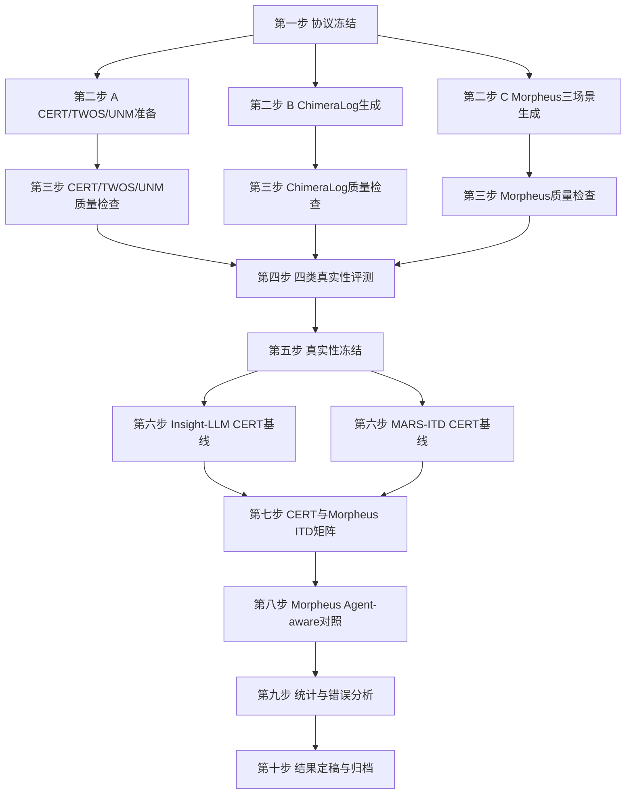

# Morpheus-Harness 并行实验节点计划

## 计划入口

- 当前 Morpheus-Harness 源码：<https://github.com/fish98/Chimera>
- CERT 数据预处理参考：<https://github.com/lcd-dal/feature-extraction-for-CERT-insider-threat-test-datasets>
- CERT 图结构检测参考：<https://github.com/Chaofan-Z/InsiderThreatDetection>
- Insight-LLM 论文：<https://doi.org/10.1145/3774904.3792398>
- MARS-ITD 论文：<https://doi.org/10.1002/spy2.70243>

## 固定数据规模

| 数据集 | 生成或抽样方式 | 数据量 | 真实性评测 | ITD 评测 |
|---|---|---:|---|---|
| CERT | 固定抽样 | 5,000 | 是 | 是，唯一外部基线 |
| TWOS | 固定抽样 | 5,000 | 是 | 否 |
| UNM | 固定抽样 | 5,000 | 是 | 否 |
| ChimeraLog | deepseek-v4.1-flash + 互联网公司场景生成 | 5,000 | 是 | 否 |
| Morpheus 互联网 | deepseek-v4.1-flash | 5,000 | 是 | 是 |
| Morpheus 金融 | deepseek-v4.1-flash | 5,000 | 是 | 是 |
| Morpheus AI | deepseek-v4.1-flash | 5,000 | 是 | 是 |

## 固定评测指标

真实性评测只使用四类指标：

1. 24 小时时序分布。
2. 相同日志模态下用户行为的多样性。
3. 跨模态事件相关性。
4. 行为复杂性。

ITD 评测使用 Insight-LLM 和 MARS-ITD，报告 Accuracy、Precision、Recall、F1、ROC-AUC 和 PR-AUC。

## 串行主线

```text
主线 A：所有数据准备与生成完成
        ↓
主线 B：所有数据质量检查完成
        ↓
主线 C：全部真实性评测完成并冻结
        ↓
主线 D：CERT 与 Morpheus ITD 评测完成
        ↓
主线 E：统计、结果定稿与归档
```

每条主线内部展开并行任务。只有当前主线的全部任务完成，下一条主线才会启动。

## 并行依赖图



## 实验节点

| 节点 | 并行任务 | 具体工作 | 交付物 | 完成条件 |
|---|---|---|---|---|
| 第一步 | 单任务 | 冻结数据规模、模型、场景、四类真实性指标、ITD 方法、ITD 数据集、主体划分、采样种子和输出 schema。 | `experiment_manifest_v1.json`、schema、参数记录。 | 主实验边界固定。 |
| 第二步 | A | 准备 CERT、TWOS、UNM，各固定 5,000 条数据。 | 三个数据切片、三个 adapter、split manifest。 | 三个数据集可由统一入口读取。 |
| 第二步 | B | 使用 deepseek-v4.1-flash 和互联网公司场景生成 5,000 条 ChimeraLog。 | ChimeraLog 原始日志、运行 manifest。 | 记录数量、模态和标签通过检查。 |
| 第二步 | C1 | 生成 Morpheus 互联网公司场景 5,000 条。 | Morpheus 互联网数据包。 | 场景生成完成。 |
| 第二步 | C2 | 生成 Morpheus 金融机构场景 5,000 条。 | Morpheus 金融数据包。 | 场景生成完成。 |
| 第二步 | C3 | 生成 Morpheus AI 公司场景 5,000 条。 | Morpheus AI 数据包。 | 场景生成完成。 |
| 第三步 | Q1 | 检查 CERT、TWOS、UNM 的解析、字段、时间、模态、标签、数量、主体划分和重复记录。 | 三个质量报告。 | 三个参考数据集通过检查。 |
| 第三步 | Q2 | 检查 ChimeraLog 的解析、日志模态、时间范围、标签和 5,000 条记录。 | ChimeraLog 质量报告。 | ChimeraLog 通过检查。 |
| 第三步 | Q3 | 检查 Morpheus 三场景的员工画像、日程、Agent、员工日志、审计日志、威胁标签和数量比例。 | 三个 Morpheus 质量报告。 | 三个场景通过检查。 |
| 第四步 | R1 | 对全部数据集并行计算 24 小时时序分布。 | 小时直方图、统计 JSON。 | 所有数据集完成相同时间分桶。 |
| 第四步 | R2 | 对全部数据集并行计算相同日志模态下的用户行为熵。 | 用户熵分布、模态对照表。 | 可用模态和缺失模态已记录。 |
| 第四步 | R3 | 对全部数据集并行计算跨模态事件相关性和共现矩阵。 | 跨模态相关性矩阵。 | 可用模态对统计完成。 |
| 第四步 | R4 | 对全部数据集并行计算行为序列归一化压缩复杂度。 | 用户复杂度分布、汇总表。 | 四类真实性任务完成。 |
| 第五步 | 汇总 | 汇总 R1–R4，比较 CERT、TWOS、UNM、ChimeraLog 和 Morpheus。独立重算部分指标。 | 真实性总表、四类图表、真实性 manifest。 | 所有真实性结果冻结。 |
| 第六步 | I1 | 在 CERT 上运行 Insight-LLM in-domain 基线。 | Insight-LLM CERT 结果、预测分数。 | CERT 基线通过复核。 |
| 第六步 | I2 | 在 CERT 上运行 MARS-ITD in-domain 基线。 | MARS-ITD CERT 结果、预测分数。 | CERT 基线通过复核。 |
| 第七步 | I3 | 运行 Insight-LLM × CERT、Morpheus 互联网、金融、AI 四个 in-domain 任务。 | Insight-LLM 四组 ITD 结果。 | 四个任务完成。 |
| 第七步 | I4 | 运行 MARS-ITD × CERT、Morpheus 互联网、金融、AI 四个 in-domain 任务。 | MARS-ITD 四组 ITD 结果。 | 四个任务完成。 |
| 第八步 | A1 | 在 Morpheus 互联网公司场景执行两个检测器的 Agent-aware 对照。 | 互联网场景消融结果。 | 对照任务完成。 |
| 第八步 | A2 | 在 Morpheus 金融机构场景执行两个检测器的 Agent-aware 对照。 | 金融场景消融结果。 | 对照任务完成。 |
| 第八步 | A3 | 在 Morpheus AI 公司场景执行两个检测器的 Agent-aware 对照。 | AI 场景消融结果。 | 对照任务完成。 |
| 第九步 | S1 | 按数据集并行计算 ITD 五个 seed 的均值和标准差。 | ITD 统计 JSON。 | 统计输入完整。 |
| 第九步 | S2 | 按数据集并行计算 95% bootstrap 区间和配对差异。 | 置信区间和差异表。 | 统计结果可重建。 |
| 第九步 | S3 | 按检测器和场景并行生成混淆矩阵、PR 曲线和错误分类。 | ITD 图表源数据、错误分析表。 | 错误分析完成。 |
| 第十步 | 单任务 | 填写 Evaluation Results，完成文档一致性检查，归档代码、环境、manifest、日志和图表。 | 结果文件、图表包、最终实验归档。 | 所有材料可由 manifest 重建。 |

## 并行执行闸门

- 第二步的 A、B、C1、C2、C3 全部完成后，进入数据质量主线。
- 第三步的 Q1、Q2、Q3 全部完成后，数据准备与生成阶段才算完成。
- 第四步 R1、R2、R3、R4 全部完成并经过第五步冻结后，真实性阶段才算完成。
- 第六步 I1、I2 与第七步 I3、I4 属于同一个 ITD 主线。它们可以在 ITD 阶段内部并行运行，最终统一汇总。
- 第七步 ITD 只包含 CERT 和 Morpheus 三个场景。ChimeraLog、TWOS、UNM 不进入 ITD。
- 第八步 Agent-aware 对照只在 Morpheus 三个场景执行。
- smoke test 只用于检查运行链路，不作为论文结果。
